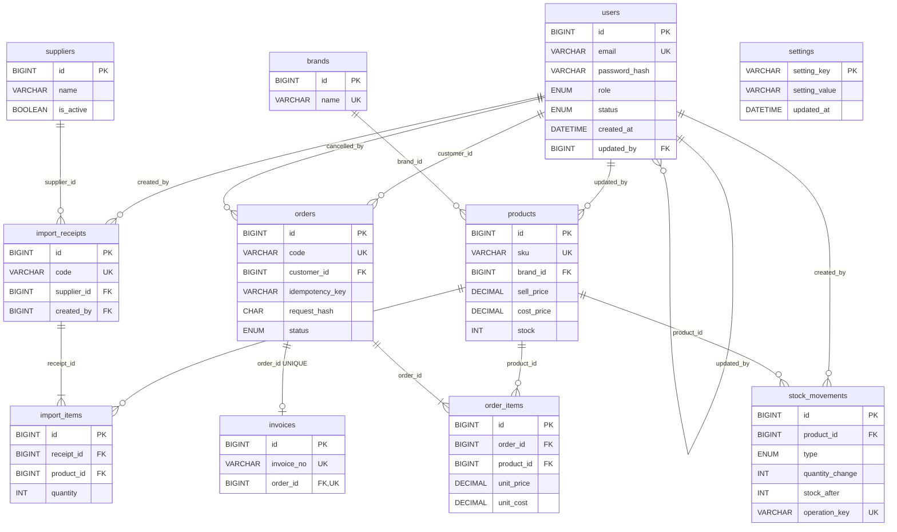

# ERD — Phone Shop (P1, Task 3)

**Ghi chú:** `stock_movements.ref_type` / `ref_id` tham chiếu logic tới nhiều loại chứng từ, nên không tạo một khóa ngoại trực tiếp cho cặp này. Service phải kiểm tra `ref_type` và lưu `operation_key` duy nhất. `invoices.order_id` là UNIQUE để mỗi đơn có tối đa một hóa đơn. Ràng buộc COMPLETED phải có hóa đơn sẽ được thực thi trong cùng transaction ở Service của Task US10/US11.

Chỉ gồm 11 bảng P1. Các bảng `auth_sessions`, `password_reset_tokens`, `stock_adjustments`, `stock_adjustment_items` (P2) và `audit_logs` (P3) được bổ sung về sau.
